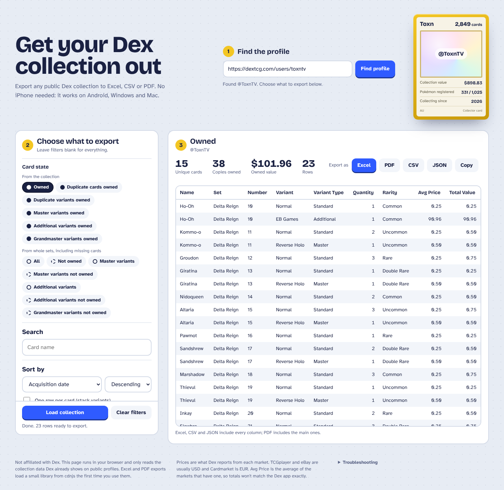

# Dex Collection Exporter

Export your [Dex](https://dextcg.com) Pokémon TCG collection to **Excel, CSV, PDF or JSON**, from any device, or move it to **Collectr** or **HoloDex**.

Dex's built-in CSV export only exists in the iOS app (and needs Dex+). If you're on Android or a PC, this page gets your collection out anyway.

## Use it

**Online:** open the hosted page at https://pulsesys-dev.github.io/dex-collection-exporter/

**Offline copy:** download [`index.html`](index.html) and open it in any browser (Chrome, Edge, Firefox, Safari). Nothing to install.

Then:

1. Paste your Dex profile link (e.g. `https://dextcg.com/users/yourname`) or just your username, and select **Find profile**.
2. Pick a card state and any filters.
3. Select **Load collection**, then export.

Your Dex profile has to be set to **public**.

## What you can filter by

The same filters as Dex's own collection and set pages:

- **Card state**
  - From your collection: owned, duplicate cards owned, duplicate variants owned, and master / additional / grandmaster variants owned
  - From whole sets, including cards you're missing: all, not owned, and master / additional / grandmaster variants (all, or only the ones you don't own)
- **Set** (only the sets you collect from), **card type**, **energy type**, **trainer subtype**, **rarity**, **variant**, **regulation mark**
- **Search** by card name, and **sort** by acquisition date, name, illustrator, price, national number or energy type
- **One row per card** or one row per variant

Duplicates show a **Spares** count, which is handy for trade lists. Missing-card exports show a **Cost to complete** based on average market prices.

## Move your collection to Collectr

Select **Collectr** to download a CSV in the TCGplayer format that [Collectr imports](https://getcollectr.notion.site/Import-Export-Your-Collection-9aa6e5f4d0cd4efb995dadc992760c8e): Quantity, Name, Simple Name, Set, Card Number, Set Code, Printing, Condition, Language, Rarity and TCGplayer Product ID. Email it to Collectr's import address from the account you use in their app.

- Only cards you own are included, using whatever filters you've loaded.
- Product IDs come from the TCGplayer links Dex stores for each variant. Cards TCGplayer doesn't sell (most Chinese cards, some stamped or special variants) have no product ID, so they're left out; the page tells you how many.
- Dex doesn't record condition, so every card is marked Near Mint.

## Move your collection to HoloDex

Select **HoloDex** to download a CSV for the HoloDex app's **Import cards** screen (Set name, Product name, Variant, Category, plus Quantity and Card number). Import it into an empty portfolio.

- HoloDex matches on TCGplayer's card names without the card number, so the file removes accents (Poke Ball, Pokemon Catcher), writes Nidoran♀ as Nidoran F, and uses TCGplayer's names for a few odd cards (e.g. Bubbly W Energy).
- Most sets use their plain name; 30th Celebration and Delta Reign use TCGplayer's set names, which is what HoloDex expects for those.
- Only English cards are included.
- Cards HoloDex doesn't list yet (McDonald's 2026, most Mega Evolution and Scarlet & Violet promos, stamped variants) show up as failed; add those with HoloDex's **Search manually**.
- When several cards share a name in one set (like the 30th Celebration Pikachus), HoloDex may file them under a different card number, but the totals are right.

## What's in the export

Name, set, set code, series, number, card ID, variant, variant type, owned, quantity, spares, card type, rarity, energy type, regulation mark, artist, TCGplayer / Cardmarket / eBay / CardTrader prices, average price, total value, language, TCGplayer product ID and printing, set release date, date added, and image URL.

- **Excel** includes a Cards sheet with filter buttons, and a Summary sheet with totals and the filters you used.
- **PDF** is landscape A4 with the main columns, ready to print or share.
- **CSV** opens in Excel or Google Sheets. **JSON** is for anything else.

Prices are what Dex reports from each market (TCGplayer and eBay are usually USD, Cardmarket EUR). "Avg Price" is the average of the markets that have a price, so totals won't exactly match the Dex app.

## Privacy

Everything runs in your browser. The page only reads the collection data Dex already shows on public profiles, and nothing is sent anywhere else. Excel and PDF exports load [SheetJS](https://sheetjs.com) and [jsPDF](https://github.com/parallax/jsPDF) from cdnjs the first time you use them.

## Troubleshooting

- **"Profile not found":** check the username, and make sure your profile is set to public in Dex.
- **"Request failed":** Dex may have updated its app. Try again later, or update `DEX_VERSION` near the top of the script in `index.html`. Pull requests welcome.

## Disclaimer

Not affiliated with, endorsed by, or connected to Dex. Pokémon and Pokémon TCG are trademarks of Nintendo, Creatures Inc. and GAME FREAK inc.

## License

[MIT](LICENSE) © Pulse Systems
